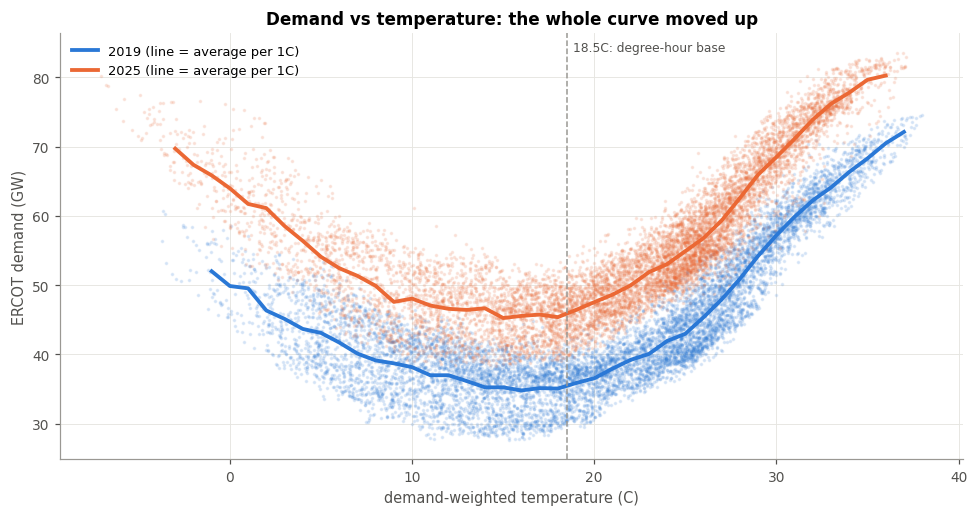
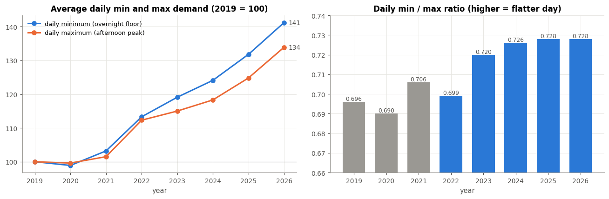
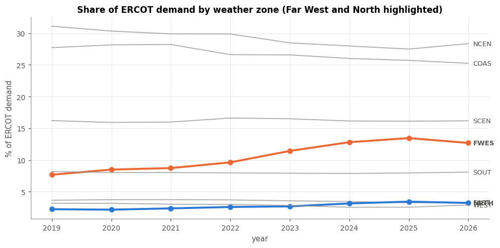
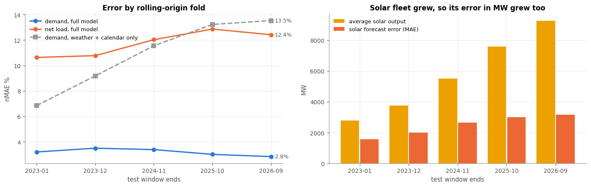
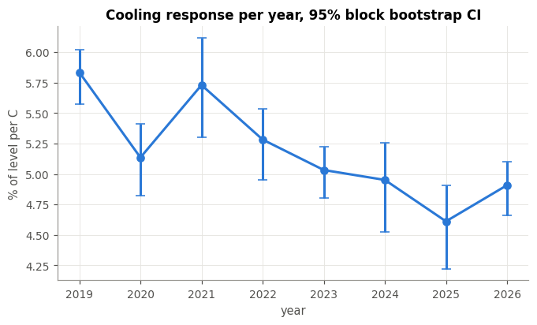
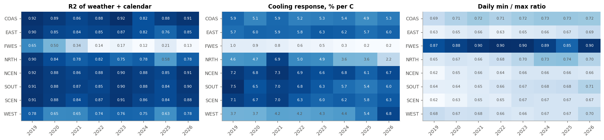
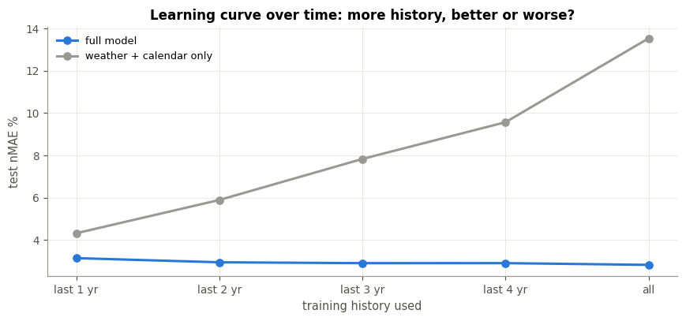
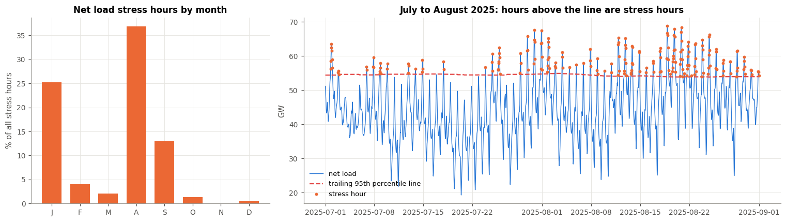

# GridPulse

**Has AI data center growth made Texas electricity harder to predict?**

Arjun Abbimutt Nagendra Kumar · UT Austin · Fall 2026

---

## Why Texas, and why now

Texas runs its own power grid, operated by ERCOT, and Texas summers are brutally hot. For decades that
made Texas electricity demand surprisingly easy to predict: when it is hot, air conditioners run and
demand climbs; at night it cools down and demand falls. Weather, time of day and day of week explained
most of what the grid needed. When weather goes to extremes, the stakes are high: Winter Storm Uri in
February 2021 left millions of Texans without power ([Busby et al., 2021](https://doi.org/10.1016/j.erss.2021.102106)).

Then AI arrived. Data centers are flooding into Texas. ERCOT's queue of large-load connection requests
passed 233 GW at the end of 2025, up almost 300% in a year, with more than 70% of it data centers
([Utility Dive](https://www.utilitydive.com/news/ercots-large-load-queue-jumped-almost-300-last-year-official/808820/)).
A data center does not care about the weather. It runs flat out, day and night, summer and winter.

So a simple question: **if a growing share of Texas demand no longer follows the weather, does Texas
electricity become harder to predict?**

### What others have looked at

- **Peak growth in ERCOT.** Skiles, Rhodes and Webber studied how ERCOT's seasonal peaks grew through
  2021, before the data center wave ([arXiv 2302.01304](https://arxiv.org/abs/2302.01304)). Their eight
  weather stations are the ones used here.
- **Data centers on the grid.** Simulation studies model how data centers would affect grid operations,
  but they assume how data center load behaves rather than measuring it
  ([Chen et al., 2025](https://arxiv.org/abs/2509.07218)).
- **Load growth forecasts.** Industry reports track how fast projected demand is rising, and caution
  that much of it may not arrive on schedule
  ([Grid Strategies, 2025](https://gridstrategiesllc.com/wp-content/uploads/Grid-Strategies-National-Load-Growth-Report-2025.pdf)).

No one had checked the actual hourly operating record with machine learning to ask whether the new load
has changed how predictable Texas is. That is what this project does.

## Hypotheses

| # | What I expected | How I tested it | Verdict |
|---|---|---|---|
| **H1** | Always-on load raises the overnight floor faster than the afternoon peak | Daily minimum vs maximum demand by year; demand share by weather zone; clustering of daily load shapes (PCA and K-means) | **Supported** |
| **H2** | This makes Texas load harder to predict | 24-hour-ahead forecasts with linear models (OLS, Ridge, Lasso) and tree models (random forest, gradient boosting), scored year by year with time-ordered cross-validation | **Rejected** for demand. Net load got harder, but only because solar grew |
| **H3** | Texas load is becoming less weather-driven for its size | Yearly regression of demand on heat and cold with bootstrap confidence intervals; the same per weather zone; a weather-only model with and without the load floor; feature importance early vs late | **Supported** |
| **H4** | Grid stress hours can be flagged a day ahead better than "same as yesterday" | Logistic regression, support vector machine and gradient boosting classifiers vs a "same as yesterday" rule, scored on precision, recall and AUC-PR | **Partly**. Yesterday is a strong rule; models add a little |

## The data

Everything is public and free. About 67,600 hours from January 2019 to September 2026.

| Source | What it is | What it does in this project |
|---|---|---|
| [EIA-930 Hourly Electric Grid Monitor](https://www.eia.gov/electricity/gridmonitor/), BALANCE files | The US government's hourly record of every US grid: demand, ERCOT's own day-ahead forecast and generation by fuel (wind, solar, gas, coal, nuclear) | Demand is what we predict. Demand minus wind and solar ("net load") is what other power plants must cover, our second target. ERCOT's forecast is the benchmark to compare against |
| EIA-930 SUBREGION files | The same demand split across ERCOT's 8 weather zones (Houston, Dallas, Far West and so on) | Shows **where** in Texas demand is growing, and lets us test each region's weather response separately |
| [Open-Meteo historical weather](https://open-meteo.com/en/docs/historical-weather-api) (ERA5) | Hourly temperature, humidity, wind, cloud and sunshine at one station per weather zone | The weather side of the story. Each zone is weighted by its share of demand to build one Texas-wide weather signal |

Five silent data problems were found and fixed along the way: EIA renamed its columns in 2024, the two
sources stamp hours differently, two columns shared a name, the target was misaligned by a day, and
same-hour wind and solar let the model rebuild the answer by arithmetic. None of them raised an error; each would have quietly corrupted the results.

## The story, in eight charts

### 1. Texas demand follows the heat, and the whole curve moved up



**What we did.** Plotted every hour of 2019 and 2025: temperature across, demand up. The lines are the
average at each degree.

**What it shows.** The classic hockey stick: demand rises steeply above about 20C as air conditioning
kicks in. In 2025 the whole curve sits about 10 GW higher, even on mild days.

**In plain words.** Texas still responds to heat, but there is now a lot more demand that is there
whatever the weather.

### 2. The overnight floor is rising faster than the afternoon peak



**What we did.** For every day, took the lowest and highest hour of demand, then averaged by year.

**What it shows.** Since 2019 the daily low rose 41% and the daily high 34%. The low-to-high ratio climbed
from 0.70 to 0.73.

**In plain words.** Days are getting flatter. Night-time demand is catching up with the afternoon, which
is what always-on load looks like.

### 3. The growth is happening in Far West Texas



**What we did.** Split Texas demand into its 8 weather zones and tracked each zone's share.

**What it shows.** Far West Texas went from 7.7% to 13.5% of all Texas demand (2019 to 2025). Houston
and Dallas lost share even though they grew.

**In plain words.** The new demand is landing in West Texas, where large industrial loads have been
connecting.

### 4. Demand did not get harder to predict. Net load did, because of solar



**What we did.** Trained a model to predict each hour 24 hours ahead from public weather, the calendar and
recent demand. Tested it on five consecutive years, always training only on the past.

**What it shows.** Left: demand error stays around 3% and is lowest in the latest year (blue). Net load
error rises from 10.6% to 12.4% (orange). A model using only weather and the calendar gets steadily worse
(grey). Right: the solar fleet tripled, so solar forecast misses in MW doubled.

**In plain words.** Hypothesis H2 was wrong for demand. Texas is still very predictable. What got harder
is predicting how much other power plants must supply, and that is because of solar growth, not the new
load.

### 5. But Texas load is responding less to weather for its size



**What we did.** For each year, measured how much demand rises per degree of heat, as a percent of the
year's base demand. Error bars are 95% confidence intervals built by resampling whole weeks.

**What it shows.** In 2019 each degree added 5.8% of base demand. In 2025, 4.6%. The early years
(2019 to 2021) and recent years (2023 to 2025) differ by 0.70 points, with a 95% interval of -0.96 to
-0.45 that does not touch zero.

**In plain words.** The drop is real, not noise. Base demand grew 31% while the extra demand per degree
grew only 4%. A shrinking share of Texas demand is about the weather.

### 6. Far West Texas has almost stopped following the weather



**What we did.** Repeated the same weather test for each zone and year. The left panel is the share of
each zone's demand that weather and the calendar explain (R2, where 1 means fully explained).

**What it shows.** In Far West Texas that share fell from 0.65 to 0.21. Houston, Dallas, Austin and
Corpus Christi stay between 0.82 and 0.92 in every year.

**In plain words.** The change is concentrated in one region. That fits large always-on loads like data
centers and crypto mining, though oil and gas activity there is another possible driver.

### 7. Old weather patterns no longer describe Texas



**What we did.** Predicted the most recent year using weather alone, trained on the last 1, 2, 3 or 4
years, or on everything.

**What it shows.** With one year of history the error is 4.3%. With all years it is 13.5%. Adding older
data makes the weather-only model worse. A full model that also knows recent demand stays near 3%.

**In plain words.** The way Texas demand responded to weather in 2019 no longer fits 2026. To stay
accurate, a forecast now has to know the rising always-on floor.

### 8. Grid stress hours: yesterday is a strong guide



**What we did.** Called an hour "stressed" when net load was in the top 5% of the past year. Then trained
classifiers to flag those hours a day ahead and compared them with a simple rule: "stressed yesterday at
this hour".

**What it shows.** About 6% of hours are stress hours, three quarters of them in July to September. The
simple rule scores 0.75 on AUC-PR (1 is perfect); the best model scores 0.77.

**In plain words.** Stress hours come in heatwave runs, so yesterday already tells you most of what you
need. Models help a little, and let an operator choose how many false alarms to accept to miss fewer
real stress hours.

## Conclusion

Texas electricity is **not** harder to predict. Demand forecasts are as accurate as ever. But the reason
they work has changed. A shrinking share of Texas demand follows the weather, the change is concentrated
in Far West Texas where large new loads are connecting and a forecast that ignores the rising
always-on floor falls apart. The real new difficulty is on the supply side: as solar grows, so do the
megawatts it can miss by.

## Limitations

- Weather inputs are actual weather, not forecasts, so real-world errors would be somewhat higher.
- ERCOT does not publish demand by customer type, so the Far West pattern is consistent with data
  center growth but does not prove it.
- The data center wave is recent, so the "after" period is short.
- ERCOT's own forecast uses private data, so it is a benchmark, not a fair contest.

## What is next

- Run the same analysis on other US grids (PJM, MISO, CAISO, SPP) to see whether Texas stands out.
- An interactive website where anyone can explore the charts, compare years and zones and see how a
  2019 model and a 2026 model respond to the same heatwave.
- A blog post with the full story.

## Repo

```
notebooks/GridPulse.ipynb   the full analysis, top to bottom, with every chart
reports/figures/            all charts, named by notebook section
reports/proposal.pdf        the original project proposal
data/README.md              data sources and how the data is handled
```

Open the notebook in Google Colab and run all. It downloads the public data on the first run.

---

*AI use: Claude (Anthropic) assisted with scoping, finding data sources, drafting code, debugging and
review. All runs, checks and analysis decisions are my own.*
